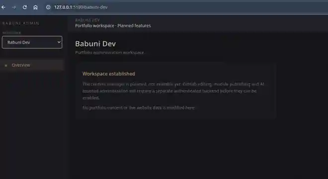

# Babuni Admin — Development Journal

## 2026-11-04 — The first local connections screen

With the local-only architecture settled, I wanted the administration tool to begin recognizing distinct projects without prematurely reaching the actual servers. AI implemented a shared Connections screen and a small registry that saves non-secret connection descriptions on my PC. A profile can be created or removed, but stays explicitly disconnected; no SSH, GitHub or database access is attempted yet. Fixture tests cover persistence and rejection of credential-like configuration. This first slice still uses the Vite development server and needs a separate local service before real privileged connections can be enabled.

## 2026-11-04 — Keeping the administration tool at home

The earlier roadmap could be read as a plan to host an administration backend somewhere on the internet. That was not what I wanted: Babuni Admin belongs on my own PC, with connections going *out* to the projects that need maintaining. After confirming that the updated application built, passed its local tests and opened in the browser, I clarified this boundary before moving into Phase 2.

AI revised the concept, architecture and roadmap around permanent local-only operation, and prepared a shared connection-manager design covering profiles, credentials, connection states and project-specific adapters. This work is documentation and design; no remote service, credential manager or connection interface was built or tested in this step.

## 2026-11-03 — Hardening the old tools without touching the live game

The next set of concerns came from what the earlier tests could not prove: PostgreSQL really deleting sessions safely, the editors really saving through their forms, and game files surviving interrupted writes. To tackle them without risking anyone's account or content, I asked AI to work with a disposable database and isolated copies of the Morkahja assets, while also addressing the npm audit findings.

AI put the changes on a review branch, added real PostgreSQL integration tests and changed moderation to use transactions. The tests deliberately made session deletion fail and verified that the player's previous state was preserved. Temporary files and retained backups replaced direct content overwrites. For the editors, small snapshots from the Morkahja repository let Chromium exercise all five forms, PNG-to-WebP conversion and a real legacy WebP image. The first runs exposed test setup and selector issues, which AI corrected before the full suite passed.

Compatible dependency updates removed all high-severity findings and all npm production-scope findings; twelve moderate tooling reports still remain. Browser-visible database credentials and client API-token handling were removed, and local development endpoints gained explicit opt-ins and request guards. The [passing CI run](https://github.com/babunidev/babuni.admin/actions/runs/41659550592) verifies 37 tests, but none of this is a substitute for production authentication or a full recovery policy. Those limits remain visible in [the hardening report](PHASE1_HARDENING_2026-11-03.md).

## 2026-11-03 — Looking beyond the green tests

With the structural milestone verified, the dependency installer was still reporting 23 vulnerabilities. A passing build could not answer how serious they were or which ones mattered for this administration tool, so I wanted the packages audited before changing versions. AI added a nonmutating audit to GitHub Actions and compared the full dependency tree against npm's production classification. Six affected packages appeared in the latter, including Vite and React Router.

The distinction matters: the tool is not a public web application yet, but Vite currently hosts local administrative endpoints capable of changing game data. That makes its development-server advisories more relevant than many conventional build-tool warnings. AI documented the package inventory, available fixes and the complicated ESLint compatibility cluster. No packages were updated during this audit; the next work remains the careful remediation and regression testing of those changes. [Audit evidence](https://github.com/babunidev/babuni.admin/actions/runs/41654264717) · [Findings](DEPENDENCY_AUDIT_2026-11-03.md).

## 2026-11-03 — Closing the first structural milestone

With the workspace migration, direct-import cleanup and isolated tests in place, I wanted a final check of what could actually be considered finished. AI reviewed the current repository, the latest successful build and test logs, and the remaining administrative boundaries. All 23 automated tests passed, alongside the build and lint checks, so the initial modular restructuring and mock-based verification can be recorded as complete.

That result does not make the old Morkahja tools production-safe. The review found that development middleware can still write without an application-level authorization layer, PostgreSQL moderation and session revocation are not transactional, and game files are overwritten without recovery guarantees. Real database workflows, the full editor interface and dependency advisories remain open. Rather than calling Phase 1 fully verified, I am retaining those limitations as explicit work before a secure administration backend can be deployed. The findings are recorded in [the Phase 1 review](PHASE1_VERIFICATION.md), supported by [CI run 41645348546](https://github.com/babunidev/babuni.admin/actions/runs/41645348546).

## 2026-11-03 — Testing the work behind the buttons

After the browser checks confirmed that navigation and the mock player table rendered, I wanted evidence that Morkahja's administrative actions also handled failures sensibly. AI built an isolated HTTP test harness around the existing local middleware, using temporary game files and injected player records instead of touching the actual database or game installation. The checks exercise moderation, the five content record types, WebP uploads and simulated failures.

Early attempts revealed that the testing router was returning HTML instead of API responses; switching to a dedicated fixture server corrected that. The first meaningful failures then exposed unsafe image filenames and acceptance of a negative portrait ID. AI tightened validation and changed client mutation handling so explicit failures cannot be shown as successes. [CI run 41644848938](https://github.com/babunidev/babuni.admin/actions/runs/41644848938) passed nine integration tests alongside the previous nine source checks, five browser checks, build and lint. The actual PostgreSQL queries, session revocation, and interactive editor forms still need separate verification before production use.

## 2026-11-03 — Testing what the browser actually displays

The earlier checks had covered the TypeScript code and mock-data functions, but not whether the workspace selector really behaved as intended on screen. With that interface now available locally, I asked AI to add automated browser checks for the actual pages and navigation. AI created a Chromium test suite against a production preview forced into mock mode, covering Babuni Dev, the original Morkahja routes, workspace switching, browser history and the mobile sidebar.

The first attempt needed adjustments to the test setup and Ubuntu runner. When Chromium finally exercised the interface, four tests passed but the mobile sidebar failed: its close button shifted the menu offscreen without making it truly hidden to accessibility checks. AI corrected the responsive visibility classes rather than weakening that assertion. [CI run 41639215405](https://github.com/babunidev/babuni.admin/actions/runs/41639215405) then passed all five browser scenarios, all nine existing tests, the build and lint. The work verifies rendered navigation and mock data only; it does not validate player moderation, game-file writes or production authentication.

## 2026-11-03 — Retiring the temporary bridges

Moving the components into their own workspaces had left temporary exports behind so existing imports would continue working. With the layout and workspace switcher now in place, I wanted to finish that transitional work instead of carrying two paths to every feature. AI traced the old imports through the Morkahja pages, components, services and PostgreSQL adapter, redirected them to their real locations, and removed 33 redundant compatibility files. The underlying shared type definitions and HTTP service stayed where they belonged.

A new regression check now guards against importing missing modules or restoring the retired shim directories. [GitHub Actions run 41565792784](https://github.com/babunidev/babuni.admin/actions/runs/41565792784) passed the build, lint and all nine tests for source commit `3786028`. The cleanup is complete at source level; full browser navigation, privileged Morkahja operations and production access remain unverified.

## 2026-11-03 — First local view of Babuni Dev

After pulling the updated repository to my computer, I launched the development server and opened the new Babuni Dev workspace in the browser. The workspace selector, dedicated header, overview navigation and informational placeholder all appeared as expected. The screenshot below records that first visible check; it was provided by me and added to the repository by AI as a reduced, cropped WebP for documentation.

This verifies the appearance of one local page, not successful navigation back to Morkahja, full browser interaction tests, access controls or content publishing.

## 2026-11-03 — Moving between workspaces

With the shared shell in place, the next step was to make the two project areas navigable without disturbing the Morkahja tools. At my direction, AI added a workspace selector to the sidebar, separated the navigation links by project, and gave Babuni Dev an overview page. The selection follows the URL, so direct links and browser history can identify the same workspace. Morkahja retains its established routes and server-status header; the Babuni Dev view explicitly says its content editor and publishing features are not available yet.

AI also added two regression checks for the workspace resolution and routing structure. [GitHub Actions run 41563642755](https://github.com/babunidev/babuni.admin/actions/runs/41563642755) passed TypeScript/Vite, ESLint and all eight tests for source commit `4f9b2ed`. These results verify the code and source contracts, not user-driven browser navigation, server authorization or production publishing. No live website or game data was changed.

## 2026-11-03 — Separating the interface from the game

A shared administration application needs boundaries that reflect what belongs to one project and what can be used by all of them. With Morkahja's domain already grouped together, I directed the next change toward the layout, reusable controls and navigation. AI moved the active layout, sidebar and UI state into `src/app/`, placed common tables, badges, headers, connection notices and formatting into `src/shared/`, and kept Morkahja's navigation entries and server-status display with the game workspace. Its existing routes and visible labels were deliberately preserved rather than presenting unfinished multi-project switching as available.

The first GitHub Actions build identified an incorrect transitional sidebar export. AI corrected that path and added a regression check for the separation. [CI run 41563231632](https://github.com/babunidev/babuni.admin/actions/runs/41563231632) passed TypeScript/Vite, ESLint and all six tests at commit `3fd29b1`. Compatibility exports still connect older imports, and the new structure has not been verified through rendered-screen, live moderation or filesystem integration tests.

## 2026-11-03 — Protecting the existing Morkahja behavior

With the TypeScript build and lint checks working, I wanted some protection against changing the existing Morkahja features while Babuni Admin grows into a multi-project tool. AI introduced a small regression suite for player ordering, encounter drafts and relationships, in-memory moderation and the established routes. The tests deliberately use local fixtures rather than connecting to player accounts or changing game files.

The first CI runs revealed test-loader issues rather than application failures. AI corrected the loader to use the project's declared TypeScript dependency and fixed its relative-import handling. [Run 41552579859](https://github.com/babunidev/babuni.admin/actions/runs/41552579859) then passed all five tests, the build and lint for commit `ba014ea`. This is the first automated regression baseline; full rendered-screen interaction, remote services and privileged writes remain outside its coverage.

## 2026-11-03 — Checking the code rules after the move

After confirming TypeScript could build the reorganized application, I wanted its lint checks addressed as well. AI added ESLint to the GitHub Actions workflow and the first run identified twelve errors. Ten came from the temporary re-export files kept for compatibility, while two concerned content-tab state and a mock-data variable. Rather than disable linting across the project, AI marked the specific compatibility exports, adjusted the tab selection to derive its active value from the route without synchronously setting state in an effect, and corrected the declaration. A newly unused effect import also had to be removed after the first retest.

[GitHub Actions run 41552146789](https://github.com/babunidev/babuni.admin/actions/runs/41552146789) passed dependency installation, the TypeScript/Vite build and ESLint for commit `72a3169`. This confirms the source checks, not the actual behavior of the Morkahja screens or privileged operations. The compatibility files and separate browser regression work remain.

The administration workbench began with Morkahja, but the growing collection of projects has made a wider structure useful. These entries tell the story from my perspective: what I wanted, what I decided, what AI implemented, and what evidence exists. Earlier source-only history is retained below rather than silently presented as a personal recollection.

## 2026-11-03 — Checking that the reorganized project still builds

After the Morkahja files had been moved into their workspace, the next important question was whether the application could still compile. At my request, AI added a GitHub Actions build workflow because the isolated local environment could not reach GitHub or the npm registry. The first CI run installed dependencies but TypeScript rejected four `../types` imports in moved Morkahja components and services. Those paths still assumed their old directories.

AI corrected the four imports on `main` and checked the resulting workflow. [GitHub Actions run 41551602985](https://github.com/babunidev/babuni.admin/actions/runs/41551602985) completed successfully: `npm ci`, `tsc -b` and `vite build` all passed. This verifies compilation and production bundling for commit `b2062fe`, not browser behavior, moderation operations, deployment or lint quality. The dependency installer also reported 23 security advisories (1 low, 14 moderate, 8 high); those require a separate dependency audit rather than an automatic breaking upgrade.

## 2026-11-03 — A shared home for administration

Managing Morkahja gave the admin tool its original purpose: player activity, moderation and game content in one interface. With babuni.dev now needing a simpler way to maintain its project documentation, I wanted to expand that tool instead of creating another separate administrator. Morkahja would become one workspace, Babuni Dev another, and future projects could have their own spaces when needed.

The assistant reviewed the existing React and Vite code and recommended keeping the frontend while separating project-specific features from the application shell. It identified a more serious boundary beneath the interface: privileged database and filesystem operations still depend on local development middleware, and browser-visible environment variables are unsuitable for credentials. A separate authenticated production API was proposed, not implemented or approved as a particular framework.

## 2026-11-03 — Giving Morkahja its own workspace

Once the direction was clear, I authorized changes to the existing repository and explained that a local backup was available. The assistant first moved the Morkahja pages, then their domain types, helpers, editor components and services into `src/features/morkahja/`. Empty areas for Babuni Dev, the shared application layer and future shell organization were also established.

Temporary re-export files preserve older import paths while the migration continues. This is useful transitional architecture rather than a second copy of the original logic. GitHub commits confirm the refactor was written, and targeted import-path checks found no missing local references in the files examined. A complete build, lint pass, browser regression, player-database test or live content-editing test was **not** run, so the reorganization cannot yet be called runtime-verified.

## 2026-11-03 — Planning editing without rebuilding the portfolio

The development journal on the public portfolio illustrated why content publishing deserves its own workbench: GitHub text could be corrected while the VPS still served an older build. The approach I want is to select a particular project module, pull its latest document, edit or review it, and publish only the content that changed. That should work for AI-assisted revisions as well, without giving agents unrestricted file or production access.

The assistant proposed keeping GitHub as the authoritative record and adding a content-publishing service that updates module metadata and search-readable pages together. The first proposed milestone is refreshing one Development Journal source file without rebuilding the entire Astro website. No editor, publishing API, automation or live-site change was implemented in this planning session.

## Earlier development history

The previous journal recorded the Morkahja-specific origin, early dashboard work, content editing, repository publication and October audits. Those historical entries follow below as originally documented; their older third-person voice and labels are archival material, not the standard for new Babuni Admin entries.

**Creator and creative director:** Babuni.dev  
**Retrospective recorded:** 2026-10-26, based on the GitHub tree, source files, initial README and historical commit diffs. This is not a raw personal chat transcript.

## Why build the backstage of a game?

Morkahja Admin is not the world that players explore. It is the creator's backstage instrument for keeping that world running and changing it. It aims to make administrative tasks—seeing active players, following activity, handling moderation and shaping encounters—possible from one deliberate interface.

The repository's original editor rules describe the aesthetic and coding discipline: **dark, minimal, atmospheric**, use strict TypeScript, favor simple reusable React components, separate APIs from UI and let the backend be authoritative. That document is valuable creative evidence. It gives an admin tool an identity without turning everyday operator work into spectacle.

This description is grounded in public source and instructions; the current audit has not recovered every private planning discussion about Morkahja, the Arcanite Brothers name, or the intended long-term hosting.

## May 23, 2026 — from blank repository to recognizable admin shell

On **2026-05-23**, the initial substantive commit `097a7be` (“initial admin dashboard scaffold”) established a React/TypeScript/Vite application with dark styling, navigation, reusable tables, metric cards and mock state. Its README clearly said that the tool still used **mock data only** and the backend connection remained to be made.

The initial route structure included typical administration placeholders such as logs, reports and world state. That is a normal scaffold shape but not, by itself, a fully operational game-control system. The code offered a visual direction and component boundaries before the true domain flows were connected.

The choice to use a local browser rather than a public-facing game page matters. The creator's project was not trying to create another destination for players; it was trying to create a tool for running and developing the existing game. Source evidence supports that product distinction, even without a recorded meeting where the idea was first articulated.

## May 24 — the content pipeline becomes a real editor

The next dated substantial commit, **`25c5604` on 2026-05-24**, had the message “Add content management, encounter editing, and dev port 5180.” The diff was broad: game-specific TypeScript types, content APIs, edit/detail panels, external asset paths, Vite middleware and PostgreSQL access replaced the earlier generic placeholder-heavy structure.

Now a creator could browse and compose **encounters**, relate them to **solutions**, inspect **expansion** contexts, and manage **avatar frames and portraits**. An editor displays real data identifiers such as encounter ID and solution choices instead of only synthetic cards. The JSON files remain in the separate MorkahjaWebApp game directory, so the admin project reads and changes assets **outside its own repository**. That external dependency is a major architectural fact to preserve in a future portfolio entry.

The same development phase introduced an operational layer: online players, player details, recent activity and moderation actions. The local PostgreSQL code can change ban/timeout flags, revoke sessions and clear sanctions. That is more than a mock UI. It is also more responsibility than a theme or prototype. Real use needs explicit operator security controls and an audit trail, which were not demonstrated by the Git history inspected here.

Several decisions are visible in implementation but not in recovered dialogue: Vite's dev server binds loopback; a proxy can attach a server-side admin key to requests; a local-content middleware reads/writes game JSON and images; and a local PostgreSQL route supports inspection and moderation. These are practical development choices. The exact motivation for each, and whether alternative architectures were debated, should not be invented.

## Where simplicity meets a hard trust boundary

The concept of an easily operated local workbench is useful, but a privileged administration tool has risks that an ordinary portfolio site does not. The code's current database connection setting is called `VITE_DATABASE_URL`, and the frontend checks it through `import.meta.env`. The same Vite naming convention makes `VITE_` values browser-accessible, which is inappropriate for a real database connection string containing credentials.

Similarly, the local Vite middleware can accept write requests for player moderation and game files. The source has no independent operator-auth check at those route handlers. The server currently binds to loopback, but “local” is a network topology choice, **not authorization**, and the content middleware mounts independently of the UI's `VITE_USE_LOCAL_CONTENT` toggle. Upload filenames and byte limits need hardening.

This audit does **not** establish a security exploit, leaked credential, or actual player harm. It records the observed boundary and the work needed before trusting a live deployment. That is part of the project history rather than an embarrassment to hide: as an experiment acquires real administrative power, responsible development has to change.

The original mock scaffold still matters, too. The live-data adapters may return sample players during development database errors, and the UI displays an explicit sample-data banner. That helps continue interface work while disconnected, but it also means the operator needs an unmistakable understanding of when records are fiction.

## The visual result

The current shell retains a muted-fantasy aesthetic. Black/slate surfaces carry fog and parchment text with bronze/gold actions; a subtle grain gives the interface texture. Reusable tables, dialogs and right-hand detail/editor panels keep the tool organized. The UI is not simply decorative: showing player status, errors and explicit confirmation before a timeout/ban is part of making serious actions readable.

Some old prototype routes did not survive the May 24 refocus. The current four screens—Dashboard, Players, Content, Settings—tell a truer story than presenting the first scaffold's imagined logs/reports/world-state sections as finished work.

## October 26 — making the work legible and attributable

On **2026-10-26**, commits `169a1af` and `99cdd36` added Babuni.dev credit in docs/package metadata, followed by `93d0360` and `c9fc2b7` establishing a minimal documentation structure and README links. The present session expands that foundation into a detailed record of product purpose, actual source paths, modes, editor behavior, trust boundaries and open verification.

**Human contribution:** the creator's project purpose, original design/coding constraints and authority over changes. **AI contribution in this documentation session:** inspection of Git/source, synthesis, analysis of modes and risks, Markdown writing and commit/verification. The available Git record does not establish who authored each May line or which AI suggestions were accepted then; this record does not invent those discussions.

**What happened in this session:** docs were rewritten and committed. **What did not happen:** no `npm install`, build, lint, browser execution, live database query, moderation action, content write, server deployment or access-control change.

## What the next development chapter should answer

Before Morkahja Admin is connected to sensitive live data as a trusted production console, how will secrets be isolated from the browser? Which backend enforces authorization? How will moderation decisions be audited and rolled back? How will content changes be reviewed and versioned across repositories? These are design and engineering questions for Babuni.dev to decide, not silent decisions made by the assistant.

The portfolio can eventually show that the creation of a game includes its production tools, the experiments that got them working, the risks recognized along the way and the collaboration methods that made later changes reviewable.

## 2026-10-28 — Audit #38: review without rewriting the past

This checkpoint encountered a project whose documentation had already been meaningfully reconstructed two days earlier. The original audit had recorded the May 23 mock-dashboard scaffold, the May 24 expansion into player and content operations, and the uncomfortable boundary between a visually useful local workbench and a truly secure administrative interface. Repeating that narrative as if it were newly discovered would obscure rather than enrich the development record.

Instead, the follow-up read the current package and Vite configuration. The app still declares a `0.0.0` package version and scripts for development, build, lint and preview, but no dedicated test command. Its local-content middleware is registered in the Vite plugins regardless of a UI-level content toggle; the database middleware is conditionally registered when a database URL exists. That is relevant source evidence, not a demonstrated security breach or proof of current deployment.

**Babuni.dev direction:** Continue the numbered documentation audits while preserving creative decisions and Git evidence. **AI contribution:** Verify the existing narrative against selected configuration and append a limited checkpoint rather than manufacture fresh history. **Verification:** Static GitHub file inspection only. **Unchanged:** Code, external game content, credentials and all live player records.

## 2026-10-31 — Review before public visibility

Babuni.dev requested review of the actual private repository and its documentation before publication. AI inspected fetched Git history, documentation coverage and publication boundaries. The publication record separates source visibility from deployment, licensing and media redistribution; detailed private findings remain outside the portfolio. No build, gameplay, live account or database test was performed.

## 2026-10-31 — Publication direction and author clarification

**Babuni.dev direction and decision:** Babuni.dev decided to make the actual project repository publicly accessible, with the intention of developing it openly rather than maintaining a separate public documentation edition. GitHub visibility was verified as public on 31 October 2026.

Public source availability does not authorize public deployment of privileged development endpoints, production credentials or live player records.

**AI contribution:** Recorded the author’s decision and clarification, separately from observed GitHub visibility. Earlier documentation-only publication was considered and is superseded as the intended long-term source. No root license was selected by this update; public visibility, open-source reuse permissions, media rights and production readiness are separate matters. No runtime testing or behavior change is claimed.
